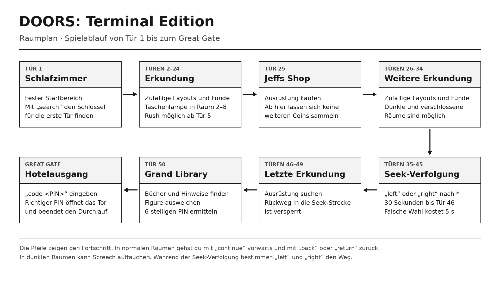

# Dokumentation der Räumlichkeiten

## Übersicht

**DOORS: Terminal Edition** führt vom Schlafzimmer hinter Tür 1 durch ein Hotel mit 50 Räumen. Die Skizze fasst aufeinanderfolgende Räume mit ähnlichem Ablauf zusammen. Jeffs Shop, die Seek-Verfolgung und die Grand Library liegen an festen Stellen.

## Raumskizze

Die Pfeile zeigen den Weg zum Ausgang. In normalen Räumen gehst du mit `continue` vorwärts und mit `back` oder `return` zurück. Während der Verfolgung wählst du mit `left` oder `right` die nächste Tür.

## Bereiche des Hotels

| Türen | Bereich | Ablauf |
| --- | --- | --- |
| 1 | Schlafzimmer | Fester Start. Mit `search` findest du den Schlüssel zur ersten verschlossenen Tür. |
| 2–24 | Erkundung | Suche nach Münzen und Ausrüstung. In einem der Räume 2 bis 8 liegt die Taschenlampe. Ab Tür 5 kann Rush erscheinen. |
| 25 | Jeffs Shop | Kaufe Ausrüstung mit den gesammelten Münzen. Ab dem ersten Erreichen des Shops kannst du keine weiteren Münzen sammeln. |
| 26–34 | Weitere Erkundung | Durchsuche die Räume vor der Verfolgung. Dunkelheit und verschlossene Ausgänge sind möglich. |
| 35–45 | Seek-Verfolgung | Nach der Cutscene hast du 30 Sekunden, um Tür 46 zu erreichen. Wähle die mit `*` markierte Seite. Eine falsche Wahl kostet fünf Sekunden. |
| 46–49 | Letzte Erkundung | Durchsuche die letzten normalen Räume. Der Rückweg in die Seek-Strecke ist versperrt. |
| 50 | Grand Library | Finde Bücher, entschlüssle den sechsstelligen PIN und weiche Figure aus. Mit dem richtigen PIN öffnest du das Great Gate und gewinnst. |

## Normale, dunkle und verschlossene Räume

Die normalen Räume verwenden acht wiederkehrende ASCII-Layouts. Funde und Zustände werden pro Raum festgelegt. Mit `look` kannst du den aktuellen Raum erneut ansehen. `map` zeigt alle Räume und die noch vorhandenen Gegenstände. `>>` markiert deinen Standort.

In dunklen Räumen können `search` und `continue` ohne eingeschaltete, geladene Taschenlampe fehlschlagen. Wenn Screech erscheint, reagierst du mit `peek`. Bei einer verschlossenen Tür liegt ein Schlüssel im jeweiligen Raum. Ein Lockpick kann das Schloss ebenfalls öffnen und wird vor dem Schlüssel verbraucht.

## Finale in der Grand Library

`source` zeigt die Reihenfolge der sechs Symbole für den PIN. Mit `findbook` findest du die dazugehörigen Ziffern. `notes` listet die bereits gefundenen Zuordnungen. Wenn Figure dich hört, hast du vier Sekunden für `hide`. Nach der Entwarnung kannst du das Versteck mit `unhide` verlassen. Gib den PIN mit `code <PIN>` ein, um das Great Gate zu öffnen.

Weitere Details stehen im [Raumplan mit Regeln pro Bereich](doors-raumplan.md) und im [README](../README.md).
