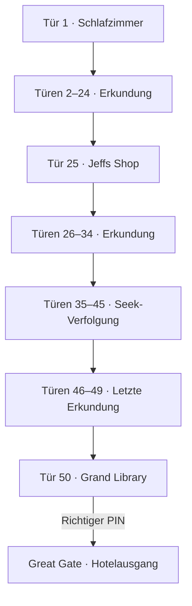

# DOORS: Terminal Edition · Raumplan

Das Hotel umfasst 50 Räume. In normalen Räumen gehst du mit `continue` vorwärts und mit `back` oder `return` zurück. In der Seek-Strecke wählst du mit `left` und `right` die nächste Tür. Nach der Flucht zu Tür 46 bleibt der Rückweg in diese Strecke gesperrt.

## Spielverlauf

## Regeln pro Bereich

| Türen | Besonderheit |
| --- | --- |
| 1 | Fester Start im Schlafzimmer. Die Ausgangstür ist verschlossen. Der Schlüssel liegt im Raum. |
| 2–8 | In einem dieser Räume liegt die Taschenlampe. |
| 2–24 | Jeder dieser Räume hat eine 70-%-Chance auf Münzen. Ab Tür 5 kann Rush erscheinen. |
| 25 | Jeffs Shop ist über `shop` und `buy <item>` verfügbar. Ab dem ersten Erreichen des Shops kannst du keine weiteren Münzen sammeln. |
| 2–24, 26–34 und 46–49 | Normale Räume mit zufälligem ASCII-Layout. Pro Raum gibt es eine 25-%-Chance auf Dunkelheit und eine 20-%-Chance auf einen verschlossenen Ausgang. Batterien und Bandagen haben je eine 20-%-Chance. Bei einem verschlossenen Ausgang liegt ein Schlüssel im Raum. |
| 35–45 | Nach der Cutscene hast du 30 Sekunden, um Tür 46 zu erreichen. Folge dem `*` und wähle `left` oder `right`. Eine falsche Wahl kostet fünf Sekunden. |
| 46–49 | Letzte normale Räume. Der Rückweg in die Seek-Strecke ist gesperrt. |
| 50 | Grand Library mit Figure. Nutze `source`, `findbook` und `notes`, um den sechsstelligen PIN zu ermitteln. Der richtige PIN öffnet mit `code <PIN>` das Great Gate und beendet das Spiel erfolgreich. |

## Orientierung und Inventar

- `look` zeigt das ASCII-Layout des aktuellen Raums.
- `map` listet alle Räume und ihre noch vorhandenen Gegenstände. `>>` markiert den aktuellen Raum.
- Das Tragegewicht ist auf 15 Punkte begrenzt. Die Taschenlampe wiegt 3, Batterie und Crucifix wiegen je 2, alle anderen Gegenstände je 1.
- Mit `drop <item>` legst du einen Gegenstand im aktuellen Raum ab. Mit `search` kannst du ihn wieder aufnehmen.

Die [Raumskizze als PNG](../diagrams/doors-raeumlichkeiten-uml.png) zeigt denselben Ablauf. Die [Dokumentation der Räumlichkeiten](doors-raeumlichkeiten-doc.md) beschreibt die Bereiche und das Finale genauer.