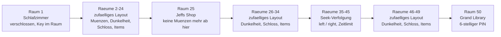

# DOORS: Terminal Edition - Raumplan

Die 50 Raeume sind eine lineare Kette (`continue` = vorwaerts, `back` = zurueck).

## Regeln pro Bereich

| Raeume | Besonderheit |
|--------|--------------|
| 1 | Schlafzimmer, Tuer verschlossen, Key liegt im Raum |
| 2-8 | In einem dieser Raeume liegt die Taschenlampe |
| 2-24 | Muenzen (70 %), danach keine mehr |
| 25 | Jeffs Shop (`shop`, `buy`) |
| 2-49 (ohne Shop und Seek) | 25 % dunkel, 20 % verschlossen (Key im selben Raum), je 20 % Batterie / Pflaster |
| 35-45 | Seek-Verfolgung, keine Dunkelheit, Schloesser oder Items |
| ab Seek-Ende | Weg zurueck in die Seek-Raeume ist eingestuerzt |
| 50 | Grand Library mit `source`, `findbook`, `notes`, `code`; kein Rush / Screech |

## Items und Gewicht

Maximales Tragegewicht: 15. Taschenlampe 3, Batterie 2, Kruzifix 2, alle anderen 1.
`drop <item>` legt Gegenstaende im aktuellen Raum ab, `map` listet alle Raeume mit ihren Items.
